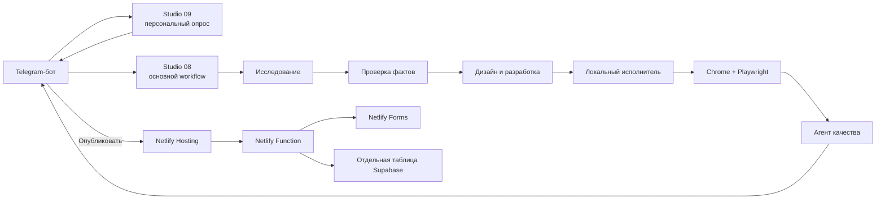

# Мультиагентная ИИ-веб-студия на n8n

Автоматизация принимает ссылку на предприятие, изучает открытые источники, задаёт персональные вопросы о будущем сайте, формирует техническое задание, создаёт одностраничный сайт, проверяет его в настоящем браузере и публикует на Netlify. Заявки посетителей одновременно сохраняются в Netlify Forms и в отдельной таблице Supabase, созданной специально для опубликованного сайта.

Система объединяет четыре части:

- **n8n** — мультиагентный бизнес-процесс;
- **Telegram** — пользовательский интерфейс;
- **Netlify** — публичный хостинг, серверная функция и резервное хранилище заявок;
- **Supabase** — основное структурированное хранилище заявок.

> Учебная реализация рассчитана на статические одностраничные сайты. Каталоги, личные кабинеты, платежи и полноценные системы бронирования требуют отдельной разработки.

---

## Содержание

1. [Что получается на выходе](#что-получается-на-выходе)
2. [Архитектура](#архитектура)
3. [Состав системы](#состав-системы)
4. [Подготовка сервисов](#подготовка-сервисов)
5. [Workflow персонального опроса](#workflow-персонального-опроса)
6. [Основной мультиагентный workflow](#основной-мультиагентный-workflow)
7. [Локальный исполнитель и браузерная проверка](#локальный-исполнитель-и-браузерная-проверка)
8. [Telegram-бот](#telegram-бот)
9. [Supabase](#supabase)
10. [Netlify Hosting и Netlify Forms](#netlify-hosting-и-netlify-forms)
11. [Полный сценарий работы](#полный-сценарий-работы)
12. [Проверка результата](#проверка-результата)
13. [Безопасность](#безопасность)
14. [Диагностика](#диагностика)
15. [Ограничения](#ограничения)
16. [Полезные ссылки](#полезные-ссылки)

---

## Что получается на выходе

Один завершённый запуск создаёт:

- готовый адаптивный `site.html`;
- локальный предпросмотр на `http://127.0.0.1:<порт>`;
- страницу доказательств `/evidence`;
- скриншот десктопной версии;
- скриншот мобильной версии;
- отчёт браузерных проверок;
- итоговый QA-статус;
- кнопку публикации в Telegram;
- отдельный сайт Netlify с HTTPS-адресом;
- рабочую форму заявки;
- форму `studio-leads` в Netlify Forms;
- отдельную таблицу Supabase вида `leads_<site_id>`;
- автоматическую тестовую заявку, подтверждающую работу обоих хранилищ.

После публикации сайт и приём заявок работают независимо от ноутбука. Ноутбук требуется для создания новых сайтов, локального браузерного теста и фоновой синхронизации заявок из Netlify Forms в Supabase после временного сбоя базы.

---

## Архитектура

### Главный принцип

Генерация сайта отделена от проверки. Модель не может самостоятельно объявить результат исправным. Финальный статус рассчитывается по фактическим данным:

- HTML действительно получен;
- страница открылась в Chrome;
- JavaScript не завершился ошибкой;
- мобильная версия не имеет горизонтального переполнения;
- ссылки и обязательные поля формы работают;
- тестовая заявка принята сервером;
- заявка появилась в хранилище;
- агент качества получил настоящий браузерный отчёт.

Публичная публикация разрешается только при успешном браузерном отчёте и итоговом статусе `passed`.

---
