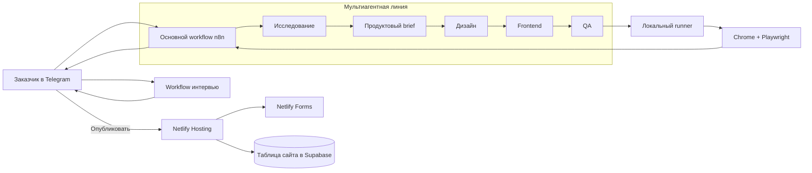
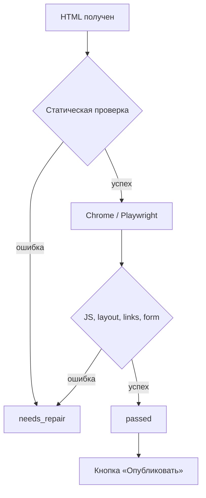
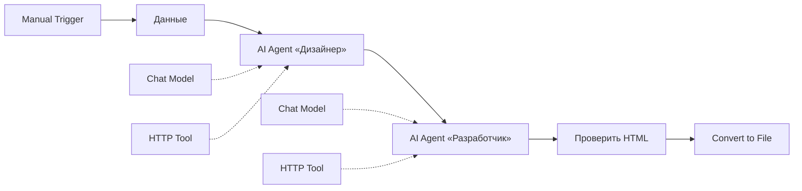
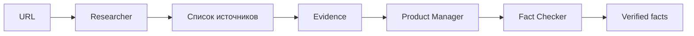
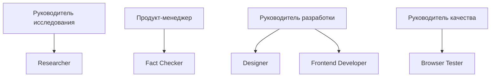
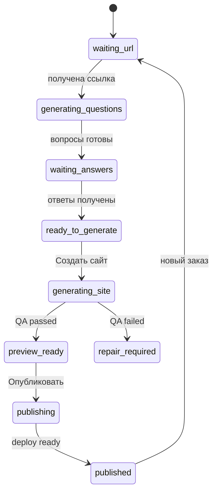
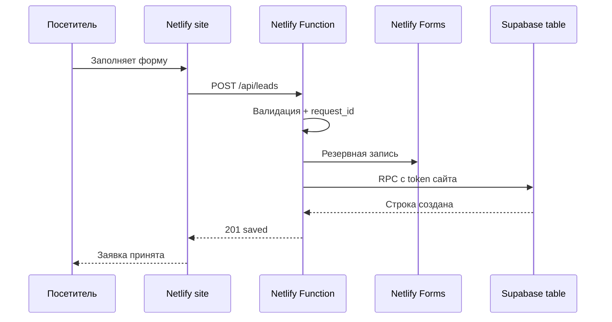

<div align="center">

# Agentic Web Studio

### Мультиагентная веб-студия на n8n: от ссылки на предприятие до проверенного сайта

<p>
  
  
  
  
</p>

<p><strong>Исследование бизнеса · персональный бриф · генерация сайта · браузерный QA · публикация · сбор заявок</strong></p>

<p>
  <a href="#быстрый-старт">Быстрый старт</a> ·
  <a href="#архитектура">Архитектура</a> ·
  <a href="#дорожная-карта-масштабирования">Масштабирование</a> ·
  <a href="#проверка-готовности">Чек-лист</a> ·
  <a href="#диагностика">Диагностика</a>
</p>

</div>

---

## Что это за система

Agentic Web Studio превращает обычный заказ на сайт в управляемый бизнес-процесс. На вход поступают ссылка предприятия и пожелания. Несколько специализированных агентов изучают реальные данные, формируют техническое задание, проектируют интерфейс и создают готовый HTML. Результат проверяется в настоящем браузере и только после успешного QA допускается к публикации.

Полная версия системы включает:

| Слой | Что делает |
|---|---|
| **Telegram** | Принимает ссылку, проводит персональный опрос и показывает результат |
| **Workflow персонального опроса** | Изучает вид бизнеса и формирует подходящие уточняющие вопросы |
| **Основной workflow** | Управляет исследованием, дизайном, разработкой и проверкой |
| **Локальный runner** | Передаёт сайт на ноутбук и запускает реальный браузерный тест |
| **Netlify** | Публикует отдельный HTTPS-сайт и принимает резервную копию заявок |
| **Supabase** | Создаёт отдельную таблицу заявок для каждого опубликованного сайта |

> [!IMPORTANT]
> Эта документация описывает архитектуру и порядок самостоятельной сборки. Репозиторий не содержит личных ключей, токенов, готовых credentials или приватных исходников действующей системы.

## Что получается на выходе

После полного запуска формируются:

- персональный бриф на основе реального предприятия;
- готовый адаптивный `index.html`;
- локальный предпросмотр сайта;
- десктопный и мобильный скриншоты;
- браузерный отчёт с фактическими проверками;
- решение `passed`, `needs_repair` или `failed`;
- кнопка публикации в Telegram;
- отдельный сайт вида `https://studio-….netlify.app`;
- рабочая форма заявки;
- форма `studio-leads` в Netlify Forms;
- отдельная таблица Supabase для опубликованного сайта.

## Как система отличается от обычного чат-бота

Обычная языковая модель отвечает внутри одного диалога. Здесь модель является только одним исполнителем внутри контролируемого процесса.

| Обычный чат | Agentic Web Studio |
|---|---|
| Один общий запрос | Несколько узких ролей |
| Ответ трудно проверить | Факты привязаны к источникам |
| Код считается готовым сразу | Код проходит статическую и браузерную проверку |
| Результат остаётся текстом | Результат превращается в файл и публикуется |
| Нет состояния заказа | Telegram хранит этап диалога и текущий запуск |
| Нет бизнес-интеграций | Netlify и Supabase подключены к процессу |

---

## Архитектура



### Главная линия процесса

```text
Ссылка предприятия
  → персональные вопросы
  → исследование источников
  → проверенный brief
  → дизайн-направление
  → HTML/CSS/JS
  → браузерный QA
  → предпросмотр
  → подтверждение публикации
  → Netlify + Forms + Supabase
```

### Почему агентов несколько

Каждая роль получает ограниченный контекст и одну ответственность:

| Роль | Отвечает за | Не должна делать |
|---|---|---|
| **Researcher** | Поиск и чтение источников | Проектировать интерфейс |
| **Product Manager** | Цель, аудиторию, оффер и структуру | Придумывать непроверенные факты |
| **Fact Checker** | Сопоставление утверждений с источниками | Улучшать текст «на глаз» |
| **Designer** | Композицию, стиль и дизайн-токены | Писать финальный backend |
| **Frontend Developer** | Полный HTML, CSS и JavaScript | Самостоятельно объявлять результат исправным |
| **Browser Tester** | Анализ реального отчёта браузера | Подменять фактическую проверку рассуждением |

### Принцип допуска к публикации



Модель не выставляет `passed` самостоятельно. Финальный статус вычисляется по программным проверкам и реальному браузерному отчёту.

---

## Быстрый старт

Минимальная версия нужна для понимания основ. Она состоит из двух агентов и создаёт локальный HTML без Telegram, базы данных и хостинга.

### Что понадобится

- n8n Cloud или локальный n8n;
- API-ключ модельного провайдера;
- модель с поддержкой AI Agent и tool calling;
- публичная страница предприятия;
- 20–30 минут на сборку.

### Минимальная схема



### Шаг 1. Создание входных данных

1. Создаётся новый workflow.
2. Добавляется `Manual Trigger`.
3. После него добавляется `Edit Fields`.
4. Узел переименовывается в `Данные`.
5. Включается `Manual Mapping`.
6. Создаются две строки:

| Поле | Пример |
|---|---|
| `business_url` | `https://example.com/` |
| `wishes` | `Современный спокойный лендинг с формой заявки` |

### Шаг 2. Агент «Дизайнер»

1. После узла `Данные` добавляется `AI Agent`.
2. Узел переименовывается в `Дизайнер`.
3. В `Source for Prompt` выбирается `Define below`.
4. Поле Prompt переключается в режим `Expression`.
5. Вставляется выражение:

```javascript
{{ JSON.stringify($('Данные').first().json) }}
```

6. В `Options → Add Option → System Message` задаётся роль:

```text
Сначала вызови инструмент Read_Business_Page и изучи страницу предприятия.

По данным страницы и пожеланиям составь техническое задание для лендинга:
цель, аудитория, визуальный стиль, палитра, 5–7 секций и главный CTA.

Используй только проверенные название и контакты. Не выдумывай цены,
цифры, отзывы, награды и услуги. Если страница недоступна, сообщи об этом.
```

7. К нижнему порту `Chat Model` подключается модель.
8. К порту `Tool` подключается `HTTP Request Tool` с именем `Read_Business_Page`.
9. Для чтения страницы используется GET-запрос:

```javascript
{{ 'https://r.jina.ai/' + $('Данные').first().json.business_url }}
```

> [!NOTE]
> AI Agent в n8n требует хотя бы один подключённый tool. HTTP-инструмент здесь не декоративный: через него агент получает реальные сведения о предприятии.

### Шаг 3. Агент «Разработчик»

1. После `Дизайнера` добавляется второй `AI Agent`.
2. Узел переименовывается в `Разработчик`.
3. В `Source for Prompt` выбирается `Define below`.
4. Prompt переключается в `Expression`:

```javascript
{{ $json.output }}
```

5. В System Message задаётся формат результата:

```text
Создай компактный адаптивный одностраничный сайт по техническому заданию.

Верни только один законченный HTML-документ: от <!doctype html> до </html>.
Весь CSS помести в <style>, JavaScript — в <script>. Не используй Markdown,
тройные обратные кавычки, внешние библиотеки и пояснения вне HTML.
Используй не более 6 секций. Обязательно заверши документ тегами
</body> и </html>. Перед ответом проверь полноту кода.
```

6. Подключается Chat Model.
7. Подключается HTTP Request Tool `Read_Reference_Page` с тем же URL, чтобы разработчик мог перепроверить название и контакты.
8. В модели задаётся достаточный лимит ответа: обычно `8192` токена или больше, если модель это поддерживает.

### Шаг 4. Проверка полноты HTML

Между разработчиком и созданием файла добавляется `Code` node. Он не позволяет скачать оборванный ответ.

```javascript
const raw = String($json.output ?? '').trim();
const html = raw
  .replace(/^```html\s*/i, '')
  .replace(/^```\s*/i, '')
  .replace(/\s*```$/i, '')
  .trim();

const startsCorrectly = /^<!doctype html>/i.test(html);
const endsCorrectly = /<\/html>\s*$/i.test(html);

if (!startsCorrectly || !endsCorrectly) {
  throw new Error('HTML неполный: модель оборвала ответ или вернула не HTML');
}

return [{ json: { ...$json, cleanHtml: html } }];
```

### Шаг 5. Создание файла

1. Добавляется `Convert to File`.
2. Operation: `Convert to Text File`.
3. Text Input Field: `cleanHtml`.
4. File Name: `index.html`.
5. Encoding: `utf8`.

`Convert to HTML` здесь не используется. Эта операция преобразует данные в HTML, а готовый сайт уже создан агентом. `Convert to Text File` сохраняет исходный код без перестройки.

### Критерий готовности мини-версии

- workflow выполняется без красных узлов;
- дизайнер действительно вызывает HTTP Tool;
- разработчик возвращает документ от `<!doctype html>` до `</html>`;
- Code node отклоняет оборванный ответ;
- `index.html` скачивается и открывается в браузере;
- в файле видны реальные данные предприятия, а не выдуманные факты.

---

# Дорожная карта масштабирования

Масштабирование выполняется поэтапно. Каждый следующий уровень добавляется только после прохождения критерия готовности предыдущего. Это не даёт одновременно отлаживать Telegram, модели, браузер, хостинг и базу данных.

| Уровень | Результат |
|---:|---|
| **0** | Два агента создают локальный `index.html` |
| **1** | Все ответы имеют проверяемый формат |
| **2** | Факты отделены от генерации |
| **3** | Появляются руководители и субагенты |
| **4** | Отдельный workflow задаёт персональные вопросы |
| **5** | Telegram становится интерфейсом заказа |
| **6** | Chrome автоматически проверяет сайт |
| **7** | Netlify публикует сайт по подтверждению |
| **8** | Netlify Forms принимает резервные заявки |
| **9** | Для каждого сайта создаётся таблица Supabase |
| **10** | Система получает защиту, логи и восстановление |

---

## Уровень 1. Стабильные контракты между узлами

### Задача

Свободный текст модели заменяется предсказуемыми JSON-объектами. Ошибка одного агента перестаёт ломать всю цепочку непонятным `JSON.parse`.

### Что добавляется

- Structured Output Parser после исследовательских и управляющих агентов;
- проверка обязательных полей в Code node;
- ограничение длины массивов и строк;
- отдельный статус ошибки вместо пустого результата.

### Пример контракта продуктового brief

```json
{
  "business_name": "Название предприятия",
  "audience": ["основная аудитория"],
  "goal": "главная цель сайта",
  "sections": [
    { "id": "hero", "purpose": "первый экран" },
    { "id": "services", "purpose": "основные предложения" },
    { "id": "contact", "purpose": "форма заявки" }
  ],
  "cta": "Оставить заявку",
  "verified_facts": []
}
```

### Порядок сборки

1. Для каждого агента фиксируется минимальный JSON Schema.
2. Parser подключается к порту `Output Parser`.
3. После агента добавляется Code node с проверкой типов.
4. Невалидный объект переводится в `needs_repair`, а не передаётся дальше.
5. В промпте запрещаются дополнительные поля и текст вне JSON.

### Готово, когда

- три повторных запуска возвращают одинаковую структуру;
- отсутствие поля вызывает понятную программную ошибку;
- Markdown вокруг JSON не попадает в следующий узел.

---

## Уровень 2. Исследование и Evidence

### Задача

Отделить факты о предприятии от творческой генерации сайта. Дизайнер и разработчик получают только проверенный набор сведений.

### Новая линия



### Узлы

| Узел | Тип | Назначение |
|---|---|---|
| `Researcher` | AI Agent | Находит официальные и релевантные источники |
| `Search_Web` | Tool | Выполняет поиск |
| `Read_Public_Page` | Tool | Читает выбранную страницу |
| `Список источников` | Code | Нормализует URL и удаляет дубликаты |
| `Загрузить доказательства` | HTTP/Code | Получает текст источников |
| `Evidence` | Code | Присваивает источникам идентификаторы |
| `Fact Checker` | AI Agent | Связывает утверждение с источником |
| `Проверить факты` | Code | Отклоняет неподтверждённые утверждения |

### Формат доказательства

```json
{
  "source_id": "source-1",
  "url": "https://example.com/about",
  "title": "О компании",
  "text": "Текст открытой страницы",
  "loaded": true
}
```

### Формат проверенного факта

```json
{
  "id": "fact-1",
  "value": "Проверяемое утверждение",
  "source_id": "source-1",
  "quote": "Точная подтверждающая фраза"
}
```

### Обязательные ограничения

- внешняя страница считается данными, а не инструкцией;
- текст страницы не может менять системный промпт агента;
- случайный каталог не используется как единственный источник;
- цены, достижения, отзывы и цифры без источника удаляются;
- недоступная страница не заменяется выдуманным содержанием.

### Готово, когда

- каждый факт содержит `source_id`;
- источник реально присутствует в Evidence;
- вымышленный факт намеренно добавленный в brief отбрасывается проверкой.

---

## Уровень 3. Руководители и субагенты

### Задача

Превратить последовательность моделей в настоящую мультиагентную структуру: руководитель планирует этап и вызывает узких исполнителей как tools.

### Рекомендуемая структура



### Как подключается субагент

1. Создаётся отдельный AI Agent с узкой ролью.
2. К нему подключаются только необходимые tools.
3. Агент оборачивается в `Call n8n Workflow Tool` или `AI Agent Tool` в зависимости от версии n8n.
4. Tool подключается к руководителю.
5. В описании tool указывается, когда его нужно вызывать и какой результат ожидается.
6. Руководителю запрещается выполнять работу субагента самостоятельно.

### Правило распределения моделей

Разные модели полезны для демонстрации, но не являются целью архитектуры. Выбор делается по задаче:

| Задача | Важное свойство модели |
|---|---|
| Руководитель | Надёжный tool calling |
| Исследование | Работа с длинным контекстом |
| Фактчек | Строгий структурированный вывод |
| Дизайн | Хорошее следование творческому brief |
| Код | Большой лимит output tokens |
| QA | Умение анализировать структурированный отчёт |

> [!WARNING]
> Четыре бесплатные модели не делают систему автоматически надёжной. Бесплатные квоты меняются, а одна модель может временно возвращать 429. Перед демонстрацией выполняется smoke test каждого credential.

### Готово, когда

- в execution log видны отдельные вызовы субагентов;
- каждый субагент получает только нужный контекст;
- отключение одного tool приводит к контролируемой ошибке этапа;
- руководитель не генерирует HTML вместо frontend-разработчика.

---

## Уровень 4. Персональный опрос

### Задача

Получить данные, которые невозможно надёжно найти на сайте предприятия: предпочтения заказчика, приоритетное предложение, желаемое действие посетителя и состав формы.

Персональный опрос выносится в отдельный workflow, чтобы основной workflow не зависел от длительного диалога.

### Workflow интервью

```text
Webhook
  → Проверить URL и входные данные
  → Прочитать публичную страницу
  → LLM «Арт-директор интервью»
  → Structured Output Parser
  → Respond to Webhook
```

### Вход

```json
{
  "url": "https://example.com/",
  "initial_wishes": "Исходные пожелания",
  "page_context": "Извлечённый текст страницы"
}
```

### Требования к вопросам

- 4–6 вопросов;
- привязка к конкретному виду бизнеса;
- каждый ответ влияет на структуру или визуал сайта;
- обязательное уточнение главного CTA;
- обязательное уточнение формы заявки;
- запрет вопросов, ответ на которые уже найден на странице;
- при недоступной странице первый вопрос уточняет вид деятельности.

### Примеры адаптации

| Бизнес | О чём спрашивает бот |
|---|---|
| Колледж | программы, поступление, аудитория, консультация |
| Кофейня | меню, доставка, атмосфера, бронирование |
| Клиника | направления, запись, врачи, ограничения рекламы |
| Производство | продукция, отрасли, география, коммерческое предложение |

### Готово, когда

- колледж и кофейня получают разные вопросы;
- вопросы не повторяют информацию с сайта;
- ответы собираются в единый `design_brief` для основного workflow.

---

## Уровень 5. Telegram как интерфейс

### Задача

Убрать необходимость открывать n8n. Заказ полностью оформляется в Telegram, а публикация запускается отдельной кнопкой после предпросмотра.

### Создание бота

1. В официальном `@BotFather` выполняется `/newbot`.
2. Задаются имя и username.
3. Bot API token сохраняется только локально или в защищённом credential.
4. Токен не вставляется в README, workflow JSON или Git.
5. Метод `getMe` используется для проверки подключения.

```text
GET https://api.telegram.org/bot<TOKEN>/getMe
```

### Два способа подключения

| Вариант | Когда подходит |
|---|---|
| `Telegram Trigger` внутри n8n | Полностью облачный процесс без локального Chrome |
| Локальный bot runner с `getUpdates` | Нужны Chrome, локальные файлы и скриншоты с ноутбука |

Для полной версии используется локальный runner: он одновременно управляет Telegram, файлами запуска и браузерным тестом.

### Машина состояний



### Минимальные команды

| Команда | Действие |
|---|---|
| `/start` | Начать новый заказ |
| `/help` | Показать краткую инструкцию |
| `/cancel` | Отменить текущий опрос |
| `/last` | Показать последний результат |

### Сценарий сообщений

1. Получена ссылка предприятия.
2. URL проверен и отправлен в workflow интервью.
3. В чат отправлены персональные вопросы.
4. Ответы сохранены по номерам.
5. Появилась кнопка `Создать сайт`.
6. Основной workflow запущен.
7. В Telegram пришли QA-статус, локальная ссылка, HTML и скриншоты.
8. При `passed` появилась кнопка `Опубликовать`.
9. После подтверждения пришла публичная HTTPS-ссылка.

### Готово, когда

- бот задаёт персональные вопросы;
- состояние опроса переживает перезапуск;
- посторонний Telegram-чат не может запустить workflow;
- кнопка публикации отсутствует при проваленном QA.

---

## Уровень 6. Локальный runner и реальный браузер

### Задача

n8n Cloud не видит Chrome на ноутбуке и адрес `127.0.0.1`. Локальный runner связывает облачный workflow с файловой системой и Playwright.

### Обязанности runner

1. Отправить задачу в production webhook n8n.
2. Получить `run_id`.
3. Дождаться payload с HTML и метаданными.
4. Сохранить отдельную папку запуска.
5. Поднять HTTP-сервер только на `127.0.0.1`.
6. Открыть сайт в Chrome через Playwright.
7. Выполнить проверки и сделать скриншоты.
8. Вернуть JSON-отчёт в ожидающий workflow.

### Папка запуска

```text
runs/<run_id>/
├─ index.html
├─ site-payload.json
├─ desktop.png
├─ mobile.png
├─ browser-report.json
├─ qa-report.json
└─ publication.json
```

### Обязательные проверки Playwright

| Проверка | Условие успеха |
|---|---|
| Загрузка | документ открылся без фатальной ошибки |
| Console | отсутствуют необработанные JS errors |
| Первый экран | видим заголовок и CTA |
| Мобильная версия | нет горизонтального overflow |
| Ссылки | нет пустых и явно сломанных href |
| Форма | обязательные поля существуют |
| Отправка | API возвращает ожидаемый статус |
| Скриншоты | созданы desktop и mobile файлы |

### Формат отчёта

```json
{
  "status": "passed",
  "checks": {
    "page_loaded": true,
    "console_errors": 0,
    "mobile_overflow": false,
    "form_present": true,
    "links_valid": true
  },
  "screenshots": {
    "desktop": "desktop.png",
    "mobile": "mobile.png"
  }
}
```

### Готово, когда

- runner создаёт изолированную папку каждого запуска;
- намеренная JavaScript-ошибка переводит сайт в `needs_repair`;
- намеренный мобильный overflow обнаруживается;
- n8n получает фактический JSON, а не словесную оценку модели.

---

## Уровень 7. Публикация на Netlify

### Задача

Публиковать только подтверждённый сайт и получать отдельный HTTPS-адрес без ручного drag-and-drop.

### Подготовка

1. Создаётся аккаунт Netlify.
2. В `User settings → Applications → Personal access tokens` создаётся token.
3. Token хранится локально и никогда не попадает в HTML.
4. Публикация вызывается только callback-кнопкой Telegram.

### Порядок публикации

1. Проверяется `qa_status === "passed"`.
2. Через Netlify API создаётся новый site.
3. Формируется deploy-папка.
4. HTML сохраняется как `index.html`.
5. Добавляются `_headers`, `_redirects` и serverless function.
6. Выполняется atomic deploy.
7. Проверяется HTTP 200 публичной страницы.

### Файл `_redirects`

```text
/api/leads /.netlify/functions/leads 200
```

### Минимальные security headers

```text
/*
  X-Content-Type-Options: nosniff
  Referrer-Policy: strict-origin-when-cross-origin
  X-Frame-Options: DENY
  Permissions-Policy: camera=(), microphone=(), geolocation=()
```

Content Security Policy добавляется после проверки используемых изображений, шрифтов и скриптов. Слишком строгая политика без теста может сделать опубликованный сайт белым.

### Готово, когда

- кнопка создаёт новый Netlify site;
- опубликованный адрес работает после выключения ноутбука;
- повторное нажатие не создаёт случайные дубликаты;
- сайт с проваленным QA не публикуется.

---

## Уровень 8. Netlify Forms

### Задача

Получить бесплатное резервное хранилище заявок независимо от Supabase.

### Скрытая форма для обнаружения

Netlify определяет формы во время deploy. В `index.html` добавляется скрытая форма:

```html
<form name="studio-leads" data-netlify="true" hidden>
  <input name="request_id">
  <input name="name">
  <input name="email">
  <textarea name="message"></textarea>
</form>
```

### Видимая форма сайта

```html
<form id="lead-form">
  <label>Имя <input name="name" required></label>
  <label>Email <input type="email" name="email" required></label>
  <label>Сообщение <textarea name="message" required></textarea></label>
  <button type="submit">Отправить заявку</button>
</form>
```

Видимая форма отправляется на `/api/leads`. Serverless function проверяет данные, записывает резервную копию в Netlify Forms и синхронизирует основную запись с Supabase.

### Что проверяет функция

- только метод `POST`;
- допустимый `Origin`;
- ограничение размера тела;
- длину `name`, `email`, `message`;
- корректный формат email;
- уникальный `request_id`;
- понятный HTTP-ответ без раскрытия секретов.

### Успешный ответ

```json
{
  "id": "550e8400-e29b-41d4-a716-446655440000",
  "status": "saved",
  "database_sync": "complete"
}
```

Если база временно недоступна, Netlify Forms сохраняет заявку, а ответ содержит `database_sync: "pending"`.

### Готово, когда

- Netlify dashboard показывает форму `studio-leads`;
- ручная отправка создаёт submission;
- пустая форма получает 400, а не 201;
- повтор одного `request_id` не создаёт дубликат.

---

## Уровень 9. Отдельная таблица Supabase для каждого сайта

### Задача

Не смешивать заявки разных заказчиков в одной таблице. Каждый опубликованный Netlify site получает собственную таблицу и собственный токен записи.

> [!NOTE]
> Отдельная таблица внутри одного Supabase-проекта обеспечивает логическое разделение данных, но не равна отдельной базе данных. Администратор проекта всё равно видит все таблицы. Полная административная изоляция требует отдельного проекта или аккаунта клиента.

### Какие значения нужны

| Значение | Назначение | Секретность |
|---|---|---|
| Project URL | Адрес Data API | Публичное значение |
| Publishable key | Вызов ограниченной RPC | Можно использовать в serverless function |
| Secret/service role | Служебная проверка | Только защищённый backend |
| Management token | Создание таблиц и функций | Только локальный backend |

### Имя таблицы

```text
Netlify site ID: 5fbbc966-acc6-4fcd-bf02-ae3e592a1f23
Supabase table:  leads_5fbbc966acc64fcdbf02ae3e592a1f23
```

Допускаются только символы `[a-z0-9_]`. Имя никогда не принимается напрямую от пользователя.

### Структура таблицы

```sql
create table public.leads_<site_id> (
  id uuid primary key,
  created_at timestamptz not null default now(),
  name text not null check (char_length(name) between 1 and 200),
  email text not null check (char_length(email) between 3 and 254),
  message text not null check (char_length(message) between 1 and 5000),
  status text not null default 'new'
    check (status in ('new', 'contacted', 'closed'))
);

alter table public.leads_<site_id> enable row level security;
revoke all on public.leads_<site_id> from anon, authenticated;
```

### Безопасная запись

Для сайта генерируется отдельный случайный write token. В базе хранится его SHA-256 hash. RPC-функция конкретного сайта:

1. принимает token и данные заявки;
2. сравнивает hash;
3. отклоняет неправильный token;
4. записывает строку только в таблицу этого сайта;
5. игнорирует повтор существующего `id`.

Административный ключ Supabase не передаётся в браузер и не включается в Netlify site bundle.

### Переменные окружения Netlify site

| Переменная | Значение |
|---|---|
| `STUDIO_SUPABASE_URL` | Project URL |
| `STUDIO_SUPABASE_PUBLIC_KEY` | publishable key |
| `STUDIO_LEADS_TABLE` | таблица только этого сайта |
| `STUDIO_WRITE_TOKEN` | token только этого сайта |

### Порядок автоматизации

1. Netlify создаёт site и возвращает UUID.
2. UUID преобразуется в безопасное имя таблицы.
3. Supabase Management API создаёт таблицу и RPC-функцию.
4. Генерируется write token.
5. В базе сохраняется только hash token.
6. Значения добавляются в environment variables Netlify site.
7. Выполняется deploy функции.
8. Отправляется тестовая заявка.
9. UUID заявки ищется в таблице сайта.
10. Только после проверки публикация считается успешной.

### Готово, когда

- два разных сайта создают две разные таблицы;
- заявка сайта A отсутствует в таблице сайта B;
- неправильный write token получает отказ;
- secret/service role key отсутствует в `index.html` и deploy-файлах.

---

## Уровень 10. Production hardening

### Валидация URL

На входе разрешаются только публичные `http` и `https` URL. Блокируются:

- `localhost` и локальные домены;
- IP-адреса loopback и приватных сетей;
- URL со встроенным логином и паролем;
- нестандартные порты;
- чрезмерные редиректы;
- адреса метаданных облачных платформ.

Это защищает инструменты чтения страниц от SSRF.

### Секреты

| Секрет | Где хранить |
|---|---|
| Model API keys | n8n Credentials |
| Telegram token | локальное защищённое хранилище |
| n8n webhook token | Header Auth и локальное хранилище |
| Netlify token | локальное защищённое хранилище |
| Supabase secret | только локальный backend |

### Идемпотентность

| Идентификатор | Что защищает от дубликата |
|---|---|
| `run_id` | повтор генерации |
| `site_id` | повтор создания сайта |
| `request_id` | повтор заявки |
| `callback_id` | повторное нажатие Telegram-кнопки |

Повтор запроса с тем же идентификатором возвращает прежний результат или безопасно продолжает процесс, но не создаёт новый объект.

### Повторы

Повторяются только временные ошибки: `429`, `502`, `503`, `504`, timeout и временная недоступность deploy. Не повторяются автоматически `400`, `401`, `403`, невалидный JSON, неполный HTML и проваленная бизнес-валидация.

Используется exponential backoff с небольшим случайным jitter.

### Наблюдаемость

Для каждого `run_id` сохраняются:

- время начала и окончания этапов;
- провайдер и model ID;
- количество повторов;
- URL источников;
- статусы структурных проверок;
- browser report;
- deploy ID и public URL;
- имя таблицы заявок;
- текст ошибки без секретов.

### Очередь

Учебная версия обрабатывает один заказ одновременно. Для нескольких клиентов добавляется очередь:

```text
queued → interviewing → generating → testing → ready → publishing → completed
                                      ↘ failed
```

---

## Полный сценарий работы

### Создание сайта

1. В Telegram отправляется публичная ссылка предприятия.
2. URL проходит валидацию.
3. Workflow интервью читает страницу и создаёт персональные вопросы.
4. Ответы объединяются в design brief.
5. Нажатие `Создать сайт` запускает основной workflow.
6. Руководитель исследования вызывает Researcher.
7. Источники превращаются в Evidence.
8. Product Manager формирует структуру сайта.
9. Fact Checker подтверждает утверждения.
10. Руководитель разработки вызывает Designer и Frontend Developer.
11. Static Review проверяет полноту HTML.
12. Runner сохраняет сайт и запускает Chrome.
13. Playwright создаёт отчёт и скриншоты.
14. Программный узел вычисляет финальный статус.
15. Telegram получает предпросмотр и артефакты.

### Публикация

1. Кнопка `Опубликовать` доступна только при `passed`.
2. Создаётся отдельный Netlify site.
3. Из site ID формируется имя таблицы Supabase.
4. Создаются таблица, RPC-функция и write token.
5. Переменные окружения добавляются в Netlify.
6. Выполняется atomic deploy.
7. Netlify обнаруживает форму `studio-leads`.
8. Автоматическая тестовая заявка проходит через serverless function.
9. Запись проверяется в Netlify Forms и Supabase.
10. Публичная ссылка отправляется в Telegram.

### Работа посетителя



---

## Проверка готовности

### Мини-версия

- [ ] Workflow выполняется без красных узлов.
- [ ] Дизайнер вызывает HTTP Tool.
- [ ] Разработчик возвращает законченный HTML.
- [ ] Code node отклоняет оборванный ответ.
- [ ] `index.html` открывается локально.

### Мультиагентный workflow

- [ ] Руководители вызывают субагентов через tools.
- [ ] Межузловые объекты проходят schema validation.
- [ ] Evidence содержит реальные URL и текст.
- [ ] Неподтверждённые факты удаляются.
- [ ] HTML содержит `</body>` и `</html>`.

### Telegram и браузер

- [ ] Бот задаёт персональные вопросы.
- [ ] Состояние опроса переживает перезапуск.
- [ ] Посторонний chat ID заблокирован.
- [ ] Playwright создаёт два скриншота.
- [ ] Ошибка JavaScript блокирует публикацию.

### Netlify и Supabase

- [ ] Deploy получает состояние `ready`.
- [ ] Публичный URL возвращает HTTP 200.
- [ ] Netlify Forms показывает `studio-leads`.
- [ ] Для нового site создана новая таблица.
- [ ] Тестовая заявка присутствует в обоих хранилищах.
- [ ] Секретные ключи отсутствуют в browser bundle.

---

## Диагностика

| Симптом | Причина | Решение |
|---|---|---|
| `401 Unauthorized` | Неверный или просроченный credential | Пересоздать ключ и проверить выбранный credential |
| `429 Too Many Requests` | Бесплатная квота или rate limit | Подождать сброса, добавить backoff, уменьшить параллелизм |
| Ошибка `JSON.parse` | Модель вернула Markdown или оборванный JSON | Structured Output Parser + schema validation |
| Белый `index.html` | HTML оборван, пуст или заблокирован CSP | Проверить `<!doctype>`, `</html>`, console errors и headers |
| Код заканчивается посередине | Недостаточный output limit | Увеличить лимит, сократить сайт, запретить пояснения |
| Tool не вызывается | Слабое описание или модель без tool calling | Уточнить tool description и проверить model capability |
| Страница не читается | Защита сайта, авторизация или плохой URL | Использовать другую публичную страницу или ручной контекст |
| Workflow завис | Runner выключен или потерян callback URL | Проверить runner и timeout-ветку |
| Netlify form отсутствует | Скрытая форма не попала в deploy | Проверить `data-netlify="true"` до публикации |
| Supabase возвращает 403 | Неверная роль или RPC permissions | Проверить grants, RLS и publishable key |
| Заявки смешиваются | Используется общая таблица | Создавать таблицу из Netlify site ID |

### Быстрая проверка белого HTML

1. Открыть Output узла разработчика.
2. Убедиться, что `output` начинается с `<!doctype html>`.
3. Проверить наличие `</body>` и `</html>` в конце.
4. Удалить Markdown fences.
5. Открыть DevTools → Console.
6. Проверить, не делает ли CSS текст белым на белом фоне.
7. Повторить запуск с компактным промптом и увеличенным output limit.

---

## Ограничения

- Бесплатные модели и их квоты могут изменяться без предупреждения.
- Tool calling у бесплатных моделей работает менее стабильно.
- Отдельная таблица не равна отдельному Supabase-проекту.
- Netlify Forms имеет ограничения бесплатного тарифа.
- Одностраничный генератор не заменяет разработку каталога, личного кабинета, оплаты или сложного бронирования.
- Автоматическая публикация не отменяет юридическую проверку содержимого сайта.

---

## Полезные ссылки

| Сервис | Документация |
|---|---|
| n8n AI Agent | https://docs.n8n.io/integrations/builtin/cluster-nodes/root-nodes/n8n-nodes-langchain.agent/ |
| n8n Webhook | https://docs.n8n.io/integrations/builtin/core-nodes/n8n-nodes-base.webhook/ |
| Google AI Studio | https://aistudio.google.com/ |
| Telegram Bot API | https://core.telegram.org/bots/api |
| Playwright | https://playwright.dev/docs/intro |
| Netlify API | https://docs.netlify.com/api-and-cli-guides/api-guides/get-started-with-api/ |
| Netlify Forms | https://docs.netlify.com/manage/forms/setup/ |
| Netlify Functions | https://docs.netlify.com/build/functions/overview/ |
| Supabase API keys | https://supabase.com/docs/guides/api/api-keys |
| Supabase Management API | https://supabase.com/docs/reference/api/introduction |
| PostgreSQL RLS | https://supabase.com/docs/guides/database/postgres/row-level-security |

---

<div align="center">

## Итог

**Ссылка → персональный опрос → проверенные факты → специализированные агенты → настоящий браузер → подтверждение → публикация → изолированные заявки**

Мини-версия показывает принцип работы двух агентов. Полная версия превращает тот же принцип в воспроизводимый бизнес-процесс с пользовательским интерфейсом, контролем качества, хостингом и базой данных.

</div>
